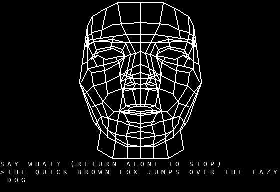
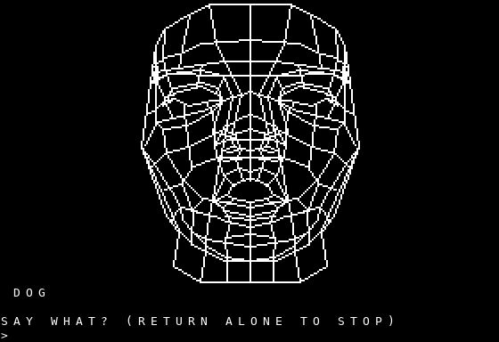
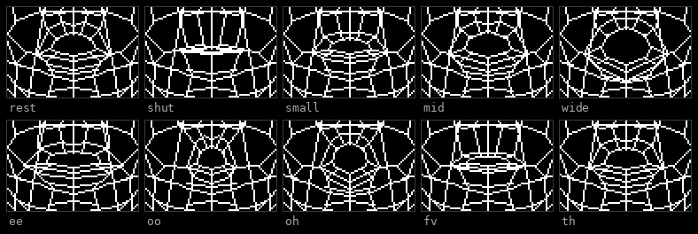
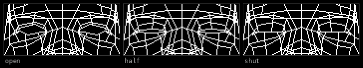
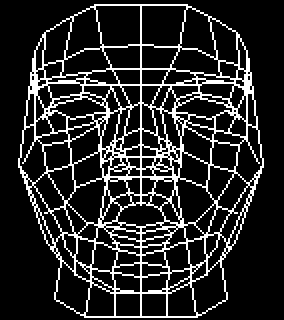

# The vector head



A talking wireframe head for the Apple II, speaking through Perfect Paul ][
with the SP0256-AL2 firmware. Type a sentence; the card says it and the mouth
moves with it.

It is a port of the CPC
[vector head](https://github.com/lambdamikel/animated-speaking-cpc-vector-head)
— same 1985 digitised model, same moving groups, same ten mouth shapes, same
three eyelid states. The model and the anchoring are unchanged; this is a new
emitter and a new renderer, not a new head.

**It will only work with this card.** The CPC version also ran on an Amstrad
SSA-1, because a real SP0256 can be asked what it is doing — `LRQ` tells you
when it has taken the next allophone and `SBY` when it has finished. Here the
74LVC245 faces one way and the slot is write-only, so there is nothing to ask.
Everything below follows from that.

---

## Running it

The disk is [`disk/vhead.dsk`](../../disk/vhead.dsk) — the SP0256 demo disk
with the head added to its menu.

```
RUN VHEAD
```

It needs the **SP0256-AL2 firmware**, not the DECtalk one, and the card in
**slot 4**. The head is drawn once, says a line of its own, and then prompts:

```
SAY WHAT? (RETURN ALONE TO STOP)
>THE QUICK BROWN FOX JUMPS OVER THE LAZY DOG
```

Return on an empty line quits. Any key during a sentence stops it and silences
the card.



---

## What moves



Ten mouth shapes, one per class of allophone, and three eyelid states:



The head blinks while it speaks *and* while it waits. Both are the same four
phases — half, shut, half, open — with the gaps cycling 2.3, 3.7, 2.9 and 4.3
seconds so it does not look metronomic.


Blinking while it waits needed the monitor's `GETLN` to go: it blocks, so
nothing can animate behind it. The line editor in `vhead.s` polls `$C000` on a
2 ms tick and runs the blink in the gaps.



---

## How it draws

The first version drew the mouth with Bresenham every time it changed. That is
**279 ms a change** on a 1 MHz 6502 — measured, not estimated: 140 ms to draw
and as much again to rub the old one out, because the shapes are EORed. Over a
sentence with 45 changes that is **12.6 s of drawing against 3.9 s of speech**.

So the drawing happens on the PC instead. `tools/mkmouth_a2.py` rasterises the
thirteen shapes once, composited over the static face, and keeps the rectangle
each group moves in as raw HGR bytes:

| | rectangle | bytes a shape |
|---|---|---|
| mouth | 10 × 48 | 480 |
| eyes | 14 × 17 | 238 |

A shape change is then a block copy — **8.70 ms** for the mouth, **3.98 ms**
for the eyes — and the old-shape-removal step disappears entirely, because the
rectangle carries the face with it.

The 6502 has no block move. `lda (zp),y / sta (zp),y / iny` is 13 cycles a
byte, which is *slower* than a Z80's `LDIR`. The gain is not the copy; it is
that a copied byte carries seven pixels and needs no address arithmetic, no
bit mask and no read-modify-write, where a plotted pixel needed all three:

| | per pixel |
|---|---|
| Bresenham and `plot` | ~257 cycles |
| block copy | ~1.9 cycles |

### OR, not EOR

The CPC EORs the mouth, because EOR is how you rub something out without
keeping a copy of what was underneath. Nothing here is ever rubbed out, so
nothing here needs EOR — and EOR had a cost: between 26 and 44 face pixels
cancelled where a shape crossed the mesh, **a different set for each shape**,
which reads as dust crawling over the face while it talks.

### Two pages

Full-screen copies go to the page that is not being displayed, and `$C054` /
`$C055` swaps them. Because the page about to be drawn into is two frames
behind the screen, "has this shape changed" is a question about *that page*,
not about the animation — ask it of the animation and the head wears a mouth
from two allophones ago, intermittently.

Mixed mode gives the four text lines underneath. That needs care: `PAGE2`
moves the **text** window to `$0800` as well as the graphics to `$4000`, and
`$0800` is where the Applesoft loader lives. But mixed mode only displays rows
20 to 23 — `$0A50` to `$0BF7` — which clears a 252-byte loader with room to
spare, so those four rows are mirrored into the second text page after every
change. **Keep that loader small.**

---

## How it keeps time

The card cannot be read back, so the lip-sync is open loop. Three things make
that work.

**The durations are measured, not read off the data sheet.** The sheet is
nominal for a real chip; the emulation plays the AL2 ROM's own frame repeat
counts, and those are shorter — OY is 291 ms against the sheet's 420, AY 173
against 260. One sentence came to 3.86 s of audio where the sheet made it
5.18 s, so the mouth was 34% slow before a pixel was drawn.
`tools/mkdur_a2.py` takes them from `pp2_render -q`:

```
d(X) = samples("X X") - samples("X")
```

which agrees with the whole sentence to 11 samples in 42553.

**The whole sentence goes to the card in one burst.** Its stage holds 4096
allophones — about fifteen seconds — so the chip then speaks to its own clock
and the animation cannot stretch it. The burst is paced at ~200 µs a byte:
the PIO receiver is eight deep and a dropped allophone cannot be detected from
this side.

**The delays are worked out as the animation runs**, from what each frame
actually cost rather than what it was predicted to cost. The loop asks the
page it is about to draw into whether it already has the right shape, charges
itself for the copies it actually made, and waits until the next shape is due.
Arithmetic is in quarter milliseconds, 16-bit, so adding four seconds of
allophones up does not wander.

Measured on the simulated 6502, running the real delay loops: **worst
per-shape error +4.5 ms, mean +0.8 ms** over a 4.4 s sentence.

### The delay loop

`delay2` waits `A × 2 ms`. The inner loop is 11 cycles, its last pass 10, and
the `ldx`/`dey`/`bne` around it another 7 — so a unit is `11k + 6`, and
`k = 185` makes that exactly the 2041 cycles 2 ms wants at 1.0205 MHz.

The first draft used 186, having counted the inner loop and forgotten the
outer. The true figure was 2052 — half a percent, **21 ms of lag over one
sentence**, and no amount of staring at the arithmetic would have shown it.
`test/cal_delay.py` measures it now.

---

## The rules, on the 6502

For the head to lip-sync text the operator types, it has to know the
allophones — and it cannot ask the card. So the NRL letter-to-sound rules run
on the Apple II as well: 320 rules, the context-class language (`# : ^ . + %
& @`), the exception table, digit expansion, and all of stage 2's positional
variants.

Two implementations of the same rules is a problem, so they are not really
two. `tools/mknrl_a2.py` generates the tables **from the firmware's own
`nrl.c`** — rules, exceptions, digit words, phoneme numbering, AL2 codes,
character classes. A rule fixed in the firmware is fixed here by rebuilding.
Only the matcher is written twice.

And the matcher is a deliberately literal transcription, **including where
`nrl.c` departs from the 1976 report**: `sibilant_at` returns 1 for C and S
before it ever looks for CH or SH, and `match_left` has no `%` case at all, so
a right context of `&` consumes one letter where a left context consumes two.
Being bug-compatible is the whole point — the card speaks what `nrl.c`
decides, and the mouth has to agree with the card, not with the report.

It costs 3508 bytes of tables, about 2 KB of code, and **~15 ms a word** — so
a ten-word sentence pauses about 150 ms between Return and the first sound.

---

## Memory

```
$0C00-$19B3  NRL rule tables          VHNRL.BIN, BLOADed
$1A00-$1F72  engine buffers, frame list
$2000-$3FFF  HGR page 1
$4000-$5FFF  HGR page 2
$6000-$8F3B  program                  VHEAD.BIN, BRUN
$9000-$9424  lookup tables and scratch
```

Two files, because one would not fit. The assembler refuses to build if the
program reaches the tables or the tables reach ProDOS:

```
.assert * <= TABLES, error, "the program has grown into the tables at TABLES"
.assert FRAMEBUF_END <= $2000, error, "the NRL buffers have run into HGR page 1"
```

Both of those have fired. The second one caught the binary growing 1.3 KB when
the eyes were added and running straight under its own lookup tables, where
`hgr_init` overwrote the allophone script on its way past — the head drew the
wrong face and spoke bytes that were never in the script, silently. Tables are
laid out from each other's sizes now (`elo = mhi + MOUTH_H`), never at round
addresses, after the eye row table was hand-placed five bytes short of `div7`
and `hgr_init` — which builds `div7` last — zeroed the top of it.

---

## Building

Needs [cc65](https://cc65.github.io/) and nothing else:

```sh
sh src/build.sh
```

The generated tables are committed, so this works as it stands. To re-derive
them:

```sh
cd tools
python3 mknrl_a2.py          # from ../../sp0256/nrl.c
python3 mkdur_a2.py          # from allo_samples.txt
python3 mkmouth_a2.py        # from ../src/headdata_a2.inc
MKHEAD=/path/to/mkhead.py python3 mkhead_a2.py
```

`mkhead_a2.py` is the only one that needs something from outside: `mkhead.py`
from the [CPC project](https://github.com/lambdamikel/animated-speaking-cpc-vector-head),
which holds the 1985 model and is where the head, the moving groups and the
ten shapes actually come from.

```sh
git clone https://github.com/lambdamikel/animated-speaking-cpc-vector-head
MKHEAD=animated-speaking-cpc-vector-head/src/mkhead.py python3 mkhead_a2.py
```

### The disk

```sh
ac -p vhead.dsk VHEAD.BIN BIN 0x6000 < src/vhead.bin
ac -p vhead.dsk VHNRL.BIN BIN 0x0C00 < src/nrldata.bin
ac -bas vhead.dsk VHEAD < src/vhload.bas
```

`ac` is [AppleCommander](https://applecommander.github.io/) — use the native
`ac-linux-amd64` binary, not the jar, which wants Java 25.

---

## Testing it without an Apple II

```sh
sh test/run.sh
```

Needs [py65](https://github.com/mnaberez/py65) and Pillow. It builds the
firmware's host tools for use as an oracle, then:

| | |
|---|---|
| `nrltest.py` | the rules against `nrl.c`, word for word. **4000 dictionary words, 0 mismatches** |
| `cal_delay.py` | what `delay2` really waits |
| `run2.py` | the face and all thirteen shapes, against the PC rasteriser |
| `run3.py` | typed text end to end: the bytes on the slot, and every frame displayed |
| `run_idle.py` | that it blinks while it waits |
| `run_text.py` | that nothing uninitialised is ever on screen |
| `run_time3.py` | sync, with the delay loops running for real |

The pixel checks decode `$2000`/`$4000` through HGR's own interleave formula
and compare against the rasteriser that produced the stored bitmaps, so they
are checking where the 6502 actually puts things rather than that the code
looks right.

`run_text.py` is worth a word. It fills the two text pages with *different*
patterns and checks, every time page 2 becomes the displayed page, that its
four visible rows match page 1's. Disable the mirroring and it reports all
nineteen — which is how a real glitch was found: page 2's text half had never
been written, so the bottom four lines showed whatever was in RAM for the
second and a half the head takes to draw, and again on every flip until the
first thing was typed.

---

## Licence

GPL-3, and everything here is ours. The 1985 BASIC and the digitisation are
Michael Wessel's; the NRL rules are Report 7948 (1976), a US Government work.
No third-party binary is used — unlike the CPC version, which calls Amstrad's
1985 SSA-1 driver for its rules, nothing here needs a byte of it.
